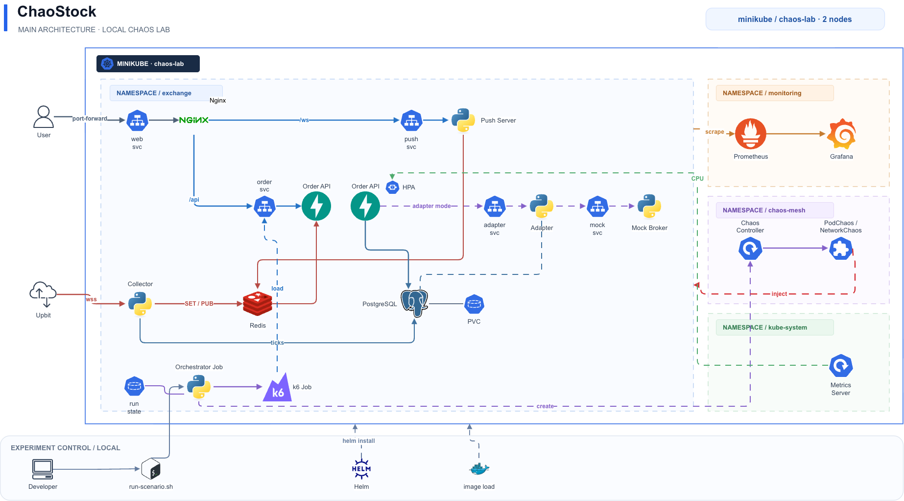
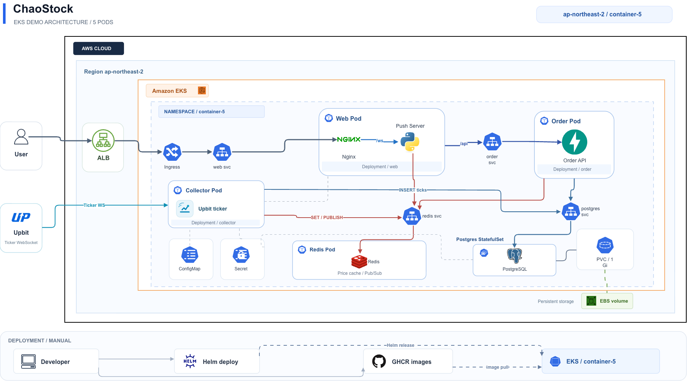

# ChaoStock

ChaoStock은 Kubernetes 기반 모의 거래 서비스에서 장애를 재현하고, 주문 처리와 데이터 정합성, 장애 이후 복구 여부를 검증하는 프로젝트다.

로컬 Minikube 환경에서 카오스 실험을 수행하고, AWS EKS에는 주요 거래 기능을 간소화한 데모를 배포한다.

## System Architecture

### Local Chaos Lab



2노드 Minikube 클러스터(`chaos-lab`)에서 실험 환경을 운영한다.

- `exchange`: Upbit WebSocket 시세 수집, Redis 시세 배포, 주문 API, 웹 화면, PostgreSQL 데이터 저장
- `monitoring`: Prometheus 지표 수집 및 Grafana 모니터링
- `chaos-mesh`: Pod 종료 및 네트워크 지연·단절 장애 주입
- `kube-system`: Metrics Server를 통한 리소스 지표 제공

주문 서비스는 Redis의 현재가를 기준으로 주문을 처리한다. 외부 주문 모드에서는 `Order API → Adapter → Mock Broker` 경로로 주문을 전달하고, 비동기 체결과 재시도를 처리한다.

실험은 k6 부하 생성, Chaos Mesh 장애 주입, 상태 관측, 복구, 결과 판정 순서로 진행한다. Orchestrator가 실행 단계를 관리하고, 주문 기록과 지표를 바탕으로 장애 영향을 판정한다.

### AWS EKS



AWS 서울 리전(`ap-northeast-2`)의 EKS `container-5` 네임스페이스에 배포하는 5-Pod 경량 데모다. ALB와 Ingress를 통해 웹 서비스에 접근한다.

| 구성 | 역할 |
| --- | --- |
| Web Pod | Nginx 웹 화면과 WebSocket Push Server 실행 |
| Order Pod | 실시간 시세 기반 주문 처리 및 계좌·포지션 조회 |
| Collector Pod | Upbit WebSocket 시세 수집 및 Redis·PostgreSQL 저장 |
| Redis Pod | 실시간 시세 캐싱 및 Pub/Sub을 통한 가격 배포 |
| PostgreSQL StatefulSet | 주문·계좌·시세 이력 저장, PVC/EBS 기반 영속 스토리지 사용 |

Collector가 Upbit에서 수신한 실시간 시세를 Redis와 PostgreSQL에 저장하며, Order 서비스는 Redis의 현재가를 기준으로 주문을 처리한다.

Helm Chart로 서비스를 배포하며, 애플리케이션 이미지는 GHCR에서 가져온다. EKS는 실시간 시세 조회와 주문 흐름을 보여 주는 데모 환경으로, Chaos Mesh 기반 장애 실험과 자동 판정은 로컬 환경에서 수행한다.

## 주요 기능

- KRW-BTC 실시간 시세 조회, 시장가 매수·매도, 잔고 및 평가손익 확인
- 주문 ID 기반 중복 처리 방지와 장애 이후 동일 주문 재시도
- Pod 종료 및 네트워크 지연·단절 실험
- k6 주문 부하 생성, Prometheus 지표 수집, Grafana 모니터링
- 실험 사전 점검, 장애 주입, 복구, 판정 결과 기록
- 외부 주문 모드의 비동기 정산 및 대기열 복구 검증

## Tech Stack

| 구분 | 기술 |
| --- | --- |
| Application | Python, FastAPI, Nginx, HTML/CSS/JavaScript |
| Database / Cache | PostgreSQL, Redis |
| Infrastructure | Docker, Kubernetes, Minikube, Helm |
| Testing | Chaos Mesh, k6 |
| Monitoring | Prometheus, Grafana, Metrics Server |
| AWS Demo | Amazon EKS, ALB, EBS, GHCR |

## Repository Structure

```text
ChaoStock/
├── .github/          # CI 및 이슈·PR 템플릿
├── deploy/eks/       # EKS 데모용 Helm Chart
├── docs/             # 설계·운영 문서, 아키텍처 및 실험 결과
├── experiments/      # 장애 시나리오와 판정 기준
├── infra/            # 로컬 클러스터 구성, Kubernetes 설정, 실행 스크립트
├── load/k6/          # 주문 부하 테스트
├── orchestrator/     # 실험 실행, 장애 주입, 복구 및 결과 판정
├── scripts/          # EKS 배포 사전 점검
├── web/              # 로컬 웹 화면과 Nginx 설정
├── workloads/        # Collector, Order, Push Server, Adapter, Mock Broker
└── Makefile          # EKS 데모 빌드·배포·검증 명령
```

## 실행 방법

### Local

Docker, Minikube, kubectl, Helm이 필요하다.

```bash
# 클러스터와 서비스 실행
bash infra/local/up.sh --with-apps

# 웹 화면 접속 (별도 터미널)
kubectl --context chaos-lab -n exchange port-forward svc/web 8080:80
# http://localhost:8080
```

외부 주문 모드로 실행할 때는 다음 명령을 사용한다.

```bash
ORDER_MODE=adapter bash infra/local/up.sh --with-apps
```

실험 전 DB 상태와 시나리오별 주문 모드를 확인한다.

```bash
bash infra/local/run-scenario.sh pod-kill
```

### EKS

EKS 접근 권한과 `container-5` 네임스페이스, DB Secret이 준비된 환경을 기준으로 한다.

```bash
make preflight ENV=eks
make status ENV=eks
make test ENV=eks
```

배포 설정은 [`deploy/eks/`](deploy/eks/)에 있으며, 웹 화면은 배포된 ALB 주소의 `/container-5/` 경로로 접근한다.

## 실험 시나리오

| 시나리오 | 검증 내용 |
| --- | --- |
| `pod-kill` | 주문 서비스 Pod 종료 후 재생성 및 주문 처리 복구 |
| `broker-delay` | 증권사 응답 지연 시 주문 접수·정산 및 대기열 회복 |
| `broker-partition` | 네트워크 단절과 응답 유실 이후 주문 재조회, 중복 체결 방지 |

시나리오와 판정 기준은 [`experiments/`](experiments/)에, 대표 실행 결과는 [`docs/results/`](docs/results/)에 정리한다.
